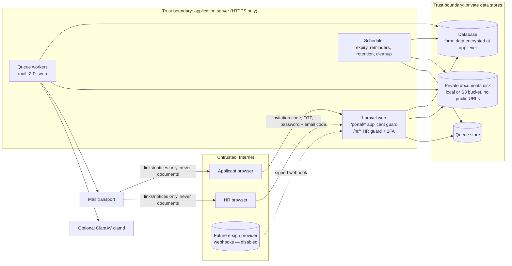

# Architecture

Status: Phase A design, subject to review. See `PROJECT_ANALYSIS.md` for rationale and `OPEN_QUESTIONS.md` for pending decisions.

## 1. Context and trust boundaries



Trust rules:
- Nothing from the applicant (field values, filenames, MIME headers, IDs in URLs) is trusted. All of it is validated server-side, and applicant-scoped queries always start from the session's applicant.
- HR requests are trusted only after password + second factor (emailed code by default, or TOTP) and policy checks. Destructive or sensitive actions require recent password confirmation.
- Email is an untrusted channel. It carries links and generic notices only.
- Webhooks (future) are verified by provider signature, timestamp tolerance and idempotency key before any processing.

## 2. Modules

| # | Module | Main classes (planned) |
|---|---|---|
| 1 | HR auth & accounts | Fortify actions, `HrUserController`, `HrUserService`, `HrUserPolicy`, `portal:hr-user:create` |
| 2 | HR 2FA | `HrEmailCodeService` + `EmailCodeController` (default, emailed code); Fortify TOTP (optional), `EnsureTwoFactorEnabled`, `PreventTwoFactorDisable` middleware, `TwoFactorSetupController` |
| 3 | Applicants | `Applicant` model, `ApplicantController`, `ApplicantPolicy`, `ApplicantProgressService` |
| 4 | Invitations | `InvitationService`, `ApplicantInvitation`, `InvitationCode` (generate/HMAC), `ApplicantOtpService` |
| 5 | Consent | `ConsentVersion`, `ApplicantConsent`, `EnsureConsentAcknowledged` middleware |
| 6 | Templates | `DocumentTemplate`, `DocumentField`, `FieldTypeRegistry` (closed set + config schema) |
| 7 | Assignments | `ApplicantDocument`, `DocumentStateMachine`, `AssignmentService` |
| 8 | Online forms | `FormRenderer` (Blade components), `FormValidator` (field → rules), draft save |
| 9 | Wet signature | Template print asset, `WetSignatureUploadController` |
| 10 | Supporting uploads | `SupportingFile`, requirement keys on template |
| 11 | Review & corrections | `ReviewService`, `CorrectionRequest` |
| 12 | Notifications | Queued `Notification` classes, `MailTemplateRenderer`, `NotificationDelivery` log, reminder command |
| 13 | Storage & naming | `UploadService`, `FileValidator`, `FileScanner` interface, `FilenameGenerator` |
| 14 | Downloads & ZIP | `DocumentDownloadController`, `BuildApplicantZip` job, `ExportArchive` |
| 15 | Audit | `AuditLogger`, `AuditEvent` (append-only), per-event metadata allowlist |
| 16 | Retention | `RetentionService`, `portal:retention:purge [--dry-run]`, `RetentionEvent` |
| 17 | Settings & health | `Setting` (typed, validated), `SettingsService`, `/hr/system` health panel (queue lag, last scheduler run, scanner status, mail failures) |
| — | E-sign (future) | `SignatureProvider` interface, `DisabledSignatureProvider`, `FakeSignatureProvider` (tests), `SignatureTransaction` |

Dependency direction: controllers → Form Requests / Policies → services → models. Services never depend on HTTP. All status changes go through `DocumentStateMachine` / `ApplicantProgressService` inside DB transactions.

## 3. Entity-relationship diagram

```mermaid
erDiagram
  users ||--o{ applicants : "created_by"
  applicants ||--o{ applicant_invitations : has
  applicants ||--o{ applicant_otps : has
  applicants ||--o{ applicant_consents : gives
  consent_versions ||--o{ applicant_consents : "acknowledged as"
  applicants ||--o{ applicant_documents : assigned
  document_templates ||--o{ document_fields : defines
  document_templates ||--o{ applicant_documents : instantiates
  document_templates ||--o{ signature_mode_approvals : authorizes
  applicant_documents ||--o{ document_versions : "uploads (versioned)"
  applicant_documents ||--o{ supporting_files : "evidence (versioned)"
  applicant_documents ||--o{ correction_requests : has
  applicant_documents ||--o{ signature_transactions : "future e-sign"
  applicants ||--o{ export_archives : "ZIPs"
  applicants ||--o{ reminder_dispatches : reminded

  users {
    bigint id PK
    string name
    string email UK
    string password
    text two_factor_secret "encrypted"
    text two_factor_recovery_codes "encrypted"
    timestamp two_factor_confirmed_at
    timestamp disabled_at
    timestamp last_login_at
  }
  applicants {
    bigint id PK
    uuid public_id UK "used in HR URLs"
    uuid applicant_ref UK "pseudonymous ref kept in audit/retention"
    string first_name
    string last_name
    string email
    string status
    bigint created_by FK
    timestamp consented_at
    timestamp completed_at
    timestamp transferred_at
    bigint transferred_by FK
    timestamp deletion_due_at
    boolean legal_hold
    text legal_hold_reason
  }
  applicant_invitations {
    bigint id PK
    bigint applicant_id FK
    char token_hash UK "HMAC-SHA256 hex"
    timestamp issued_at
    timestamp expires_at
    timestamp first_used_at
    timestamp last_used_at
    timestamp revoked_at
    string revoke_reason
    timestamp sent_at
    string delivery_status
    int failed_attempts
    bigint created_by FK
  }
  applicant_otps {
    bigint id PK
    bigint applicant_id FK
    bigint invitation_id FK
    string code_hash
    timestamp expires_at
    int attempts
    timestamp consumed_at
  }
  consent_versions {
    bigint id PK
    string version UK
    string title
    longtext body
    char body_sha256
    timestamp effective_at
    boolean active
    bigint created_by FK
  }
  applicant_consents {
    bigint id PK
    bigint applicant_id FK
    bigint consent_version_id FK
    timestamp acknowledged_at
    string ip_address "optional"
    string user_agent "optional, truncated"
  }
  document_templates {
    bigint id PK
    string code UK "e.g. I9, SSA89"
    string name
    text description
    text instructions
    boolean required_by_default
    string input_mode
    string signature_mode
    json allowed_extensions
    int max_size_kb
    json supporting_requirements "validated schema"
    string filename_pattern "nullable override"
    string print_asset_path "private disk"
    int sort_order
    boolean active
  }
  signature_mode_approvals {
    bigint id PK
    bigint document_template_id FK
    string signature_mode
    string authorized_by_name "client/legal approver"
    string approval_reference "e.g. email/memo ref"
    text notes
    bigint recorded_by FK
    timestamp authorized_at
  }
  document_fields {
    bigint id PK
    bigint document_template_id FK
    string field_key
    string label
    string type "closed set"
    json config "validated per type"
    boolean required
    boolean sensitive "mask in HR UI"
    int sort_order
  }
  applicant_documents {
    uuid id PK "opaque, always scoped to applicant"
    bigint applicant_id FK
    bigint document_template_id FK
    boolean required
    string status
    text form_data "encrypted:array"
    string signature_mode_snapshot
    string input_mode_snapshot
    bigint current_version_id FK
    timestamp assigned_at
    timestamp submitted_at
    timestamp reviewed_at
    bigint reviewer_id FK
  }
  document_versions {
    bigint id PK
    uuid applicant_document_id FK
    int version_number
    string disk
    string storage_path "random, never user-derived"
    string original_filename "metadata only"
    string generated_filename
    string mime_type
    bigint size
    char sha256
    string scan_status
    string uploaded_by_type
    bigint uploaded_by_id
    timestamp uploaded_at
    timestamp superseded_at
  }
  supporting_files {
    bigint id PK
    uuid applicant_document_id FK
    string requirement_key
    int version_number
    string disk
    string storage_path
    string original_filename
    string generated_filename
    string mime_type
    bigint size
    char sha256
    string scan_status
    timestamp uploaded_at
    timestamp superseded_at
  }
  correction_requests {
    bigint id PK
    uuid applicant_document_id FK
    bigint requested_by FK
    string scope "document|supporting:key|field:key"
    text message
    string status
    timestamp resolved_at
  }
  signature_transactions {
    bigint id PK
    uuid applicant_document_id FK
    string provider
    string provider_reference
    string status
    json signer_evidence_refs
    json attestation
    char document_sha256
    string certificate_path
    char last_webhook_hash
    timestamp signed_at
  }
  export_archives {
    uuid id PK
    bigint applicant_id FK
    bigint requested_by FK
    string status
    string storage_path
    bigint size
    timestamp expires_at
  }
  reminder_dispatches {
    bigint id PK
    bigint applicant_id FK
    bigint invitation_id FK
    string reminder_key "idempotency"
    timestamp sent_at
  }
  audit_events {
    bigint id PK
    string actor_type "hr|applicant|system"
    string actor_ref "user id or applicant_ref"
    string event
    string subject_type
    string subject_ref
    uuid applicant_ref "no FK; survives purge"
    json metadata "allowlisted keys only"
    string ip_address
    string user_agent
    timestamp occurred_at
  }
  retention_events {
    bigint id PK
    uuid applicant_ref
    string action "dry_run|purge|skip_legal_hold|failure"
    timestamp due_at
    timestamp completed_at
    string result
    json metadata "counts only"
  }
  notification_deliveries {
    bigint id PK
    string event
    string recipient_type
    string recipient_ref
    string status
    string provider_message_id
    string error_class "no message bodies"
    timestamp sent_at
  }
  settings {
    string key PK
    json value
    bigint updated_by FK
  }
```



Notes on deletion vs. audit:
- `audit_events`, `retention_events` and `notification_deliveries` have **no foreign keys** to applicant tables. They reference the random `applicant_ref` UUID, so purging an applicant cascades all PII rows while the pseudonymous evidence stays.
- Applicant-owned tables cascade on applicant delete. File binaries are deleted **before** the DB rows by `RetentionService`, with verification. On failure the purge is aborted for that applicant and reported.
- `users` referenced as actor use `restrictOnDelete`. HR users are disabled, never deleted, while referenced.
- Soft deletes are **not** used for applicant data. Deletion is meant to be real. `applicants.status = retention_pending` is the only pre-delete holding state.

## 4. Route map

> The authoritative list is `routes/web.php` (`php artisan route:list`). Implemented paths differ slightly from the original plan. For example, files are served at `/hr/applicants/{applicant}/files/{version|supporting}/{id}`, ZIPs at `/hr/applicants/{applicant}/exports/{export}`, and disclosure versions are managed at `/hr/consent`.

### Applicant portal (`/portal`, `applicant` middleware group, short sessions)
| Method | Path | Purpose |
|---|---|---|
| GET | `/portal/access` | Code entry (JS lifts `#code` fragment into a POST form) |
| POST | `/portal/access` | Validate code (rate-limited, generic errors) |
| GET/POST | `/portal/verify` | Email confirmation + OTP |
| POST | `/portal/logout` | End session |
| GET/POST | `/portal/consent` | Show active consent version, acknowledge |
| GET | `/portal` | Checklist / progress |
| GET | `/portal/documents/{doc}` | Document detail and instructions |
| PUT | `/portal/documents/{doc}/draft` | Save draft answers |
| GET | `/portal/documents/{doc}/print` | Download blank wet-sign PDF |
| POST | `/portal/documents/{doc}/upload` | Upload signed document |
| POST | `/portal/documents/{doc}/supporting/{key}` | Upload supporting file |
| GET | `/portal/documents/{doc}/review` | Summary before submit |
| POST | `/portal/documents/{doc}/submit` | Submit |
| GET | `/portal/complete` | Completion confirmation |

`{doc}` is resolved **only** through `currentApplicant()->documents()->findOrFail()`. A document belonging to another applicant returns 404, the same as a non-existent one.

### HR (`/hr`, `auth` + `2fa.enforced` + policies)
| Method | Path | Purpose |
|---|---|---|
| GET | `/hr` | Dashboard (counts, filters) |
| resource | `/hr/applicants` | List/search/create/edit/show |
| POST | `/hr/applicants/{a}/invitations` | Issue / reissue |
| DELETE | `/hr/applicants/{a}/invitations/{i}` | Revoke |
| GET | `/hr/applicants/{a}/documents/{d}` | Review view (SSN fields masked) |
| POST | `/hr/applicants/{a}/documents/{d}/reveal` | Audited reveal of sensitive field (password-confirmed) |
| POST | `/hr/applicants/{a}/documents/{d}/approve` | Approve |
| POST | `/hr/applicants/{a}/documents/{d}/corrections` | Request correction |
| GET | `/hr/files/{type}/{id}/download` / `preview` | Authorized streaming |
| POST | `/hr/applicants/{a}/exports` | Queue ZIP |
| GET | `/hr/exports/{e}/download` | Download ZIP (requester-scoped, expiring) |
| POST | `/hr/applicants/{a}/transfer` | Mark transferred (starts retention clock) |
| POST | `/hr/applicants/{a}/legal-hold` | Set/clear legal hold |
| DELETE | `/hr/applicants/{a}` | Manual delete (password confirm + typed confirmation) |
| DELETE | `/hr/applicants/{a}/files/{type}/{id}` | Delete an individual file |
| GET | `/hr/applicants/{a}/activity` | Audit timeline |
| resource | `/hr/templates`, `/hr/consent-versions`, `/hr/users` | Configuration (password confirm on write) |
| GET/PUT | `/hr/settings` | Reminders, naming, retention, upload limits, mail templates |
| GET | `/hr/system` | Health panel |

### Future
- `POST /webhooks/esign/{provider}`: returns 404 while the provider is `disabled`.

## 5. Key data flows

### 5.1 Invitation → first access
```mermaid
sequenceDiagram
  participant HR
  participant App
  participant Mail
  participant Ap as Applicant
  HR->>App: Issue invitation
  App->>App: revoke active invites; code = random(160 bits); store HMAC(code); expires = +7d
  App->>Mail: queue InvitationMail(link /portal/access#code)
  App->>App: audit invitation.issued (no code)
  Mail->>Ap: email
  Ap->>App: POST code (fragment moved into body by JS)
  App->>App: lookup HMAC, check not revoked/expired, rate limit
  Ap->>App: confirm email
  App->>Mail: OTP to email ON FILE (generic UI response)
  Ap->>App: POST OTP
  App->>App: regenerate session; bind applicant_id+invitation_id
  App-->>Ap: consent page (gate) → checklist
```

### 5.2 Upload
Validate size → extension allowlist → `finfo` MIME must match allowed extension → reject dangerous signatures (PHP/HTML/JS/SVG/executables/macro-enabled Office) → stream to `documents/{applicant_ref}/{random}.bin` → SHA-256 → scan (or mark `not_scanned`) → create version and supersede previous → state machine transition → audit `document.uploaded` (template code, version, size, hash prefix only) → queued HR notification.

### 5.3 ZIP export
HR requests → policy → `BuildApplicantZip` job queries **only** `applicant->documents->current versions + current supporting files` → entry names are built solely by `FilenameGenerator` (never from stored paths/user input) under `{Last}_{First}_Packet_{date}/{nn}_{DocCode}/…` → written to `exports/` on the private disk → `export_archives.expires_at = now + EXPORT_TTL_MINUTES` → HR downloads via authorized route → scheduler deletes expired archives.

### 5.4 Retention purge
Scheduler (daily) → `RetentionService::eligible()` (status `transferred`, `deletion_due_at <= now`, no legal hold) → dry-run report **or** purge: delete binaries → verify → transaction: delete applicant (cascade) → `retention_events` + `audit_events` with `applicant_ref` only.
